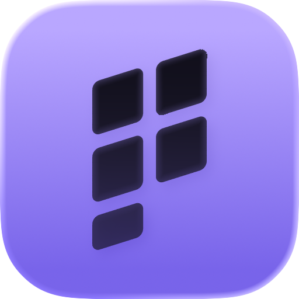
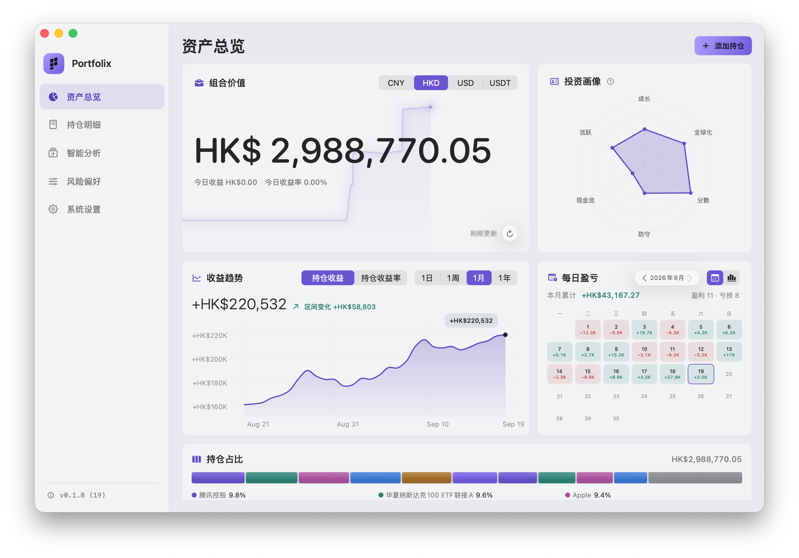
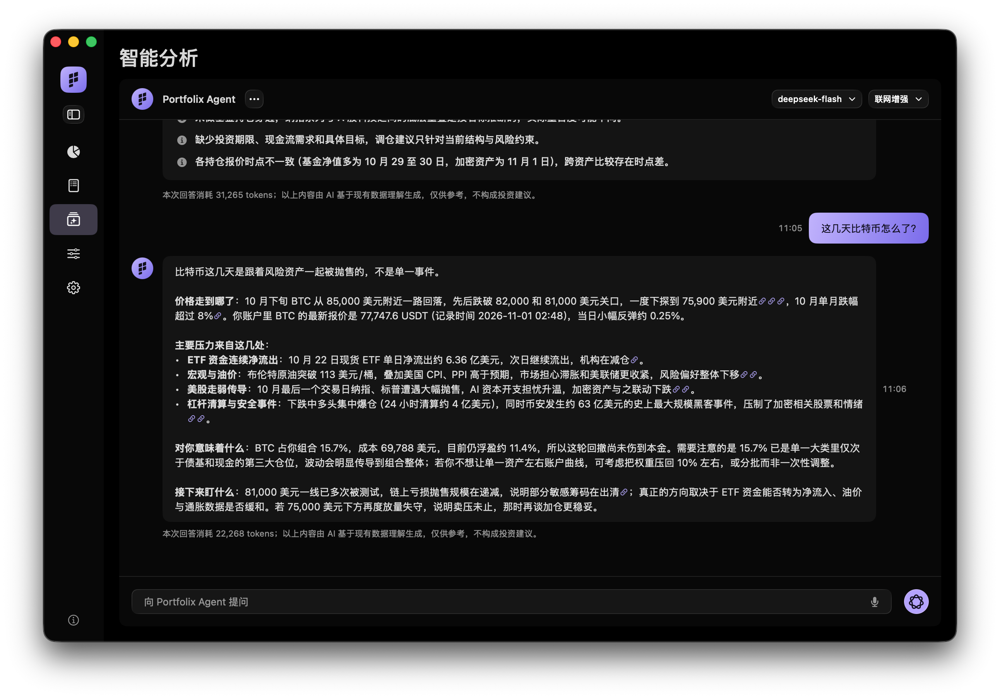

# Portfolix

中文 | [English](#english)

## 简介

Portfolix 是一款轻量、简洁的原生 macOS 资产记账工具，专注持仓记录与收益跟踪。记录资产的添加、增持、卖出和现金变化，清楚了解组合价值与收益；需要更多参考时，再按需使用 AI 分析。

  

  

Portfolix 不连接券商账户，也不执行真实交易，无需提供券商或理财平台的密码、Cookie 或交易凭证。持仓、操作记录、历史收益、资产价格和风险偏好默认保存在本机，可自行导出备份。

## 功能

- **多类资产**：记录 A 股、B 股、美股、港股、公募基金、数字货币和现金。
- **操作记账**：添加或增持资产，记录部分或全部卖出、现金转出，保留可撤销的操作记录。
- **收益跟踪**：查看组合价值、盈亏日历、持仓收益趋势和持仓占比。
- **投资云图**：查看今日盈亏与投资分布；未开启 AI 时，按资产类别展示分布。
- **语音录入**：通过本机语音输入资产信息，减少手动填写。
- **本地备份**：导出和恢复持仓、操作记录、每日收益、资产价格及风险偏好。

## 行情与持仓

支持自动行情的股票、基金和数字货币可查询公开价格，无需额外配置行情 API Key。持仓份额与资金变化由你记录，不会自动同步券商或理财平台的账户。

每次完全退出后重新打开 App（包括首次打开），都会额外刷新一次支持自动行情的资产价格。这次刷新独立于后台定时刷新开关，不改变后台刷新计划。

首次创建账本时，会提供 Apple、NVIDIA 和 BTC 三项示例持仓，可自行编辑或删除；已有账本不会添加示例，删除后也不会自动补回。

## 可选功能

基础记账与收益跟踪无需配置 AI。

- **AI 辅助分析**：使用自己的 DeepSeek API Key 生成报告、提问或分析资产的实际投资领域。联网增强可按需启用 Parallel Search、DeepSeek Search、Tavily、博查、Exa 或 AnySearch。
- **只读 MCP**：授权本机 Agent 查询持仓、收益和操作记录，支持 ChatGPT / Codex、Claude、DeepSeek Harness、WorkBuddy；客户端配置可在 App 中查看。

使用 AI 分析或授权其他 Agent 时，相关数据可能发送至所用模型服务。

## 许可证

Portfolix 源代码使用 Apache License 2.0 授权。详见 `LICENSE`。

Portfolix 名称、Logo、App Icon 和品牌资产不自动作为商标授权。详见 `TRADEMARK.md`。

---

# English

[中文](#portfolix) | English

**A lightweight, local-first macOS app for simple portfolio records and performance tracking, with optional AI insights.**

## Overview

Portfolix is a lightweight, native macOS app focused on recording holdings and tracking returns. Record asset additions, position increases, sales, and cash changes, follow your portfolio's value and performance, and use AI analysis when you need another perspective.

Portfolix does not connect to brokerage accounts or execute real trades. It requires no brokerage or investment-platform passwords, cookies, or trading credentials. Holdings, transaction records, historical returns, asset prices, and risk preferences are stored locally by default and can be exported for backup.

## Features

- **Multiple asset types**: Record A-shares, B-shares, US and Hong Kong stocks, public funds, digital currencies, and cash.
- **Transaction records**: Add assets, increase positions, and record partial or full sales and cash withdrawals, with reversible records.
- **Performance tracking**: Follow portfolio value, the P&L calendar, holding return trends, and holding allocations.
- **Investment map**: Explore today's P&L and investment distributions, with asset-category distributions when AI is disabled.
- **Voice input**: Enter asset information using on-device speech recognition to reduce typing.
- **Local backups**: Export and restore holdings, transaction records, daily returns, asset prices, and risk preferences.

## Quotes and Holdings

Automatic quotes are available for supported stocks, funds, and digital currencies without a separate market-data API key. You record position quantities and cash changes yourself; brokerage and investment-platform accounts are not automatically synchronized.

Each fresh app launch, including the first launch, refreshes supported asset prices once. This extra refresh runs independently of background updates and leaves their schedule unchanged.

A new ledger starts with editable Apple, NVIDIA, and BTC sample holdings. Existing ledgers are unchanged, and deleted samples do not return.

## Optional Features

Asset records and performance tracking work without configuring AI.

- **AI-assisted analysis**: Use your own DeepSeek API key to generate reports, ask questions, or identify underlying investment sectors. Optionally enable Parallel Search, DeepSeek Search, Tavily, Bocha, Exa, or AnySearch for web research.
- **Read-only MCP**: Authorize local agents to query holdings, returns, and transaction records. Supports ChatGPT / Codex, Claude, DeepSeek Harness, and WorkBuddy, with client configuration references available in the App.

When you use AI analysis or authorize other agents, relevant data may be sent to their model providers.

## License
The Portfolix source code is licensed under the Apache License 2.0. See LICENSE for details.

The Portfolix name, logo, App Icon, and brand assets are not automatically licensed as trademarks. See TRADEMARK.md for details.
